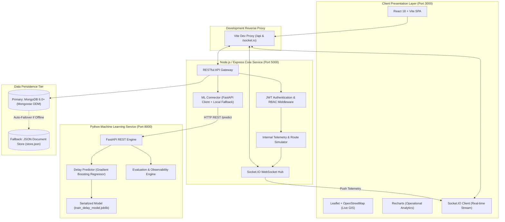
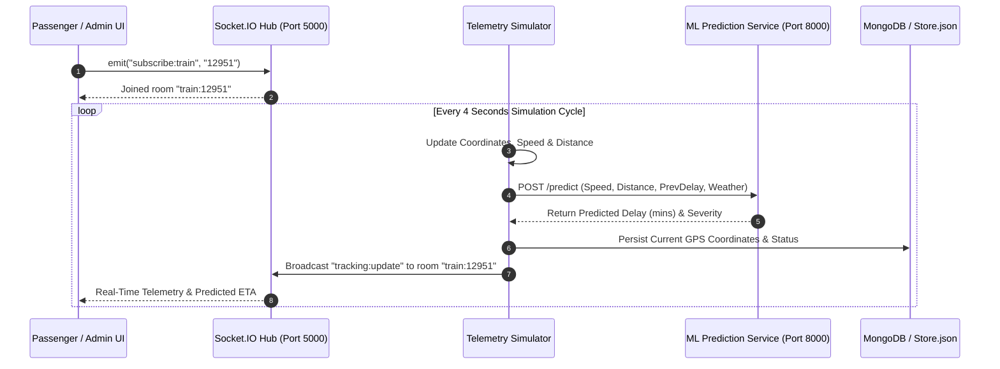
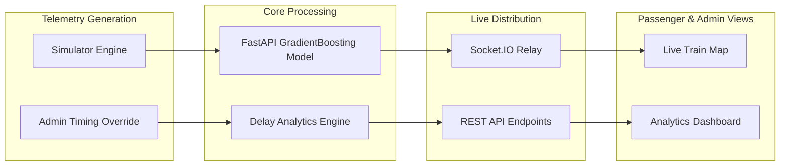

# RTTPS System Architecture & Engineering Design

The **Railway Time Tracking and Prediction System (RTTPS)** is an academic full-stack web platform built for high-concurrency train tracking, real-time telemetry processing, and machine learning-powered arrival/departure delay prediction.

---

## 1. High-Level Architectural Diagram

The system employs a multi-tiered, service-oriented architecture connecting a dynamic single-page application (SPA), an asynchronous real-time Node.js backend with an internal physics-based telemetry simulator, a Python FastAPI microservice executing scikit-learn models, and a resilient dual-layer database engine.

---

## 2. Core Architectural Subsystems

### A. Presentation Layer (React + Vite)
- **Framework:** React 18 single-page application built on Vite for sub-second hot module reloading and optimized production tree-shaking.
- **Styling:** Tailwind CSS with responsive mobile-first layouts, high-contrast operational status indicators, and dark-theme accents.
- **Geographic Visualization:** Leaflet with OpenStreetMap tiles rendering real-time train positioning, multi-segment route polylines, and interactive station marker tooltips.
- **Real-Time State:** Socket.IO client subscribed to train-specific rooms (`train:<number>`) and fleet-wide channels (`fleet:broadcast`).
- **Role-Based Routing:** Protected route guards enforcing `PASSENGER` and `ADMIN` role privileges with automatic token hydration and expiration handling.

### B. Application & API Gateway (Node.js & Express)
- **RESTful Endpoints:** Modular express routers handling User Auth, Fleet Management, Timetables, Telemetry, Predictions, Notifications, and Operational Analytics.
- **Authentication & Security:** Stateless JSON Web Tokens (JWT) signed with HMAC-SHA256, bcrypt salted password hashing (10 salt rounds), CORS protection, and role-based authorization gates (`authorize('ADMIN')`).
- **Resilient ML Connector (`mlService.js`):** Queries the Python FastAPI prediction microservice over HTTP. If the microservice is temporarily offline, it seamlessly falls back to an embedded heuristic regression algorithm, ensuring zero 500 errors.

### C. Real-Time Telemetry & Movement Simulator (`simulatorService.js`)
- Runs as an active background loop inside the Node.js server.
- Uses piecewise linear spherical interpolation across real-world Indian Railways coordinates (e.g., New Delhi, Kota, Ratlam, Vadodara, Surat, Borivali, Mumbai Central, Kanpur, Prayagraj, Varanasi, Howrah).
- Simulates realistic physical dynamics including cruising speed, station dwell times, braking curves, and operational anomalies.
- Emits real-time position, speed, and delay telemetry every 4 seconds to connected Socket.IO clients.

### D. Machine Learning Intelligence Tier (Python FastAPI & Scikit-learn)
- **Dataset:** 15,000 synthetic historical trips generated with domain-specific railway parameters (distance, station dwell times, speed constraints, weather disruptions, track maintenance, peak hour congestion).
- **Model Architecture:** `GradientBoostingRegressor` evaluated against `RandomForestRegressor`. Achieved Mean Absolute Error (MAE) of **3.28 minutes** and an $R^2$ score of **0.9838**.
- **Inference Service:** FastAPI application providing `/predict`, `/metrics`, and `/health` endpoints with Pydantic V2 validation and cross-origin security.

### E. Resilient Dual-Engine Persistence
- **Primary Engine:** MongoDB via Mongoose ODM supporting document schemas, indexing on `trainNumber`, `role`, and `timestamp`.
- **Persistent Failover Engine:** In academic or restricted environments where a MongoDB daemon cannot run, the system automatically switches to `backend/src/data/store.json`. The persistence layer transparently wraps file I/O with standard Mongoose-compatible query methods (`find`, `findOne`, `create`, `updateOne`, `save`).

---

## 3. Data Flow Architecture

---

## 4. Hardware vs. Simulation Boundaries

> [!IMPORTANT]
> **Academic Simulation Notice:**
> The train coordinates, speeds, and running conditions are generated by the system's mathematical telemetry engine using real geographic station coordinates of the Indian Railways network. The platform does NOT connect to live Indian Railways CRIS/NTES internal GPS hardware. All live positions must be treated as simulated telemetry demonstrating full-stack real-time IoT tracking capabilities.
