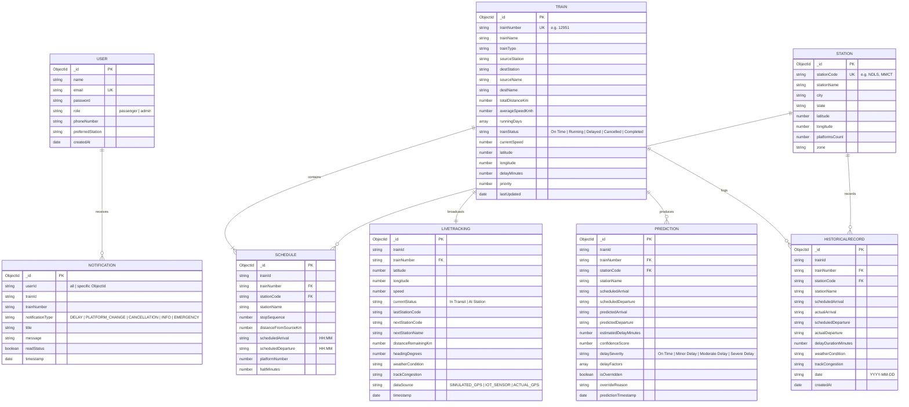

# RTTPS Database Schema & Persistence Architecture

The Railway Time Tracking and Prediction System uses a normalized document-based data model optimized for high-read transit schedules, streaming telemetry updates, and audit logging.

The system natively supports two persistence modes:
1. **Primary:** MongoDB 6.0+ via Mongoose ODM.
2. **Failover:** Automatic persistent JSON File Store (`backend/src/data/store.json`) requiring zero database configuration.

---

## 1. Entity-Relationship Diagram



---

## 2. Collection Schemas & Field Specifications

### 2.1 `users`
Represents registered passengers and system administrators.
- `_id`: Unique identifier (ObjectId / UUID).
- `name` (String, required): Full name of the user.
- `email` (String, required, unique): Login identifier.
- `password` (String, required): Bcrypt hashed password (10 salt rounds).
- `role` (String, enum: `['passenger', 'admin']`, default: `'passenger'`): RBAC level.
- `phoneNumber` (String, optional): Contact number for SMS alerts.
- `preferredStation` (String, optional): Station code for personalized dashboard feed.
- `createdAt` (Date): Registration timestamp.

### 2.2 `stations`
Geographic coordinates and infrastructure details for Indian Railways hubs.
- `stationCode` (String, required, unique): Official 3-4 letter IR code (e.g., `NDLS`, `MMCT`, `CNB`).
- `stationName` (String, required): Full junction / terminal name.
- `city` (String, required): City name.
- `state` (String, required): State name.
- `latitude` (Number, required): WGS84 decimal latitude.
- `longitude` (Number, required): WGS84 decimal longitude.
- `platformsCount` (Number, default: 5): Total physical platforms available.
- `zone` (String, default: `'NR'`): Railway operational zone (e.g., `NR`, `WR`, `NCR`, `ER`).

### 2.3 `trains`
Fleet registry containing operational parameters and live snapshot status.
- `trainNumber` (String, required, unique): 5-digit Indian Railways train number (e.g., `'12951'`).
- `trainName` (String, required): Official service name (e.g., `'Mumbai Tejas Rajdhani Express'`).
- `trainType` (String): Express category (e.g., `'Rajdhani'`, `'Vande Bharat'`, `'Superfast'`).
- `sourceStation` (String, required): Origin station code.
- `destStation` (String, required): Terminus station code.
- `totalDistanceKm` (Number): Total scheduled travel distance.
- `averageSpeedKmh` (Number): Operating speed baseline.
- `runningDays` (Array of Strings): Operational days of the week (`['Mon', 'Tue', ...]`).
- `trainStatus` (String, enum: `['On Time', 'Running', 'Delayed', 'Cancelled', 'Completed']`).
- `currentSpeed` (Number): Current speed in km/h.
- `latitude` / `longitude` (Number): Current spatial coordinate.
- `delayMinutes` (Number): Current delay behind schedule.
- `priority` (Number): Operational precedence (1: Highest, 3: Standard).
- `lastUpdated` (Date): Telemetry heartbeat timestamp.

### 2.4 `schedules`
Defines route sequences, planned station halts, and assigned platforms.
- `trainNumber` (String, required): Associated train number.
- `stationCode` (String, required): Stop station code.
- `stationName` (String, required): Human-readable station name.
- `stopSequence` (Number, required): Sequential order along the route ($1, 2, 3, \dots$).
- `distanceFromSourceKm` (Number): Distance traversed from origin.
- `scheduledArrival` (String, format `'HH:MM'`): Planned arrival.
- `scheduledDeparture` (String, format `'HH:MM'`): Planned departure.
- `platformNumber` (Number, default: 1): Assigned platform.
- `haltMinutes` (Number, default: 5): Scheduled dwell time.

### 2.5 `livetrackings`
High-frequency spatial and dynamic state updates emitted by the simulator / GPS feed.
- `trainNumber` (String, required): Associated train.
- `latitude` / `longitude` (Number, required): Current position.
- `speed` (Number): Speed in km/h.
- `currentStatus` (String): `'In Transit'`, `'Approaching Station'`, `'At Station'`.
- `lastStationCode` (String): Most recently departed station.
- `nextStationCode` / `nextStationName` (String): Upcoming stop.
- `distanceRemainingKm` (Number): Distance to final terminus.
- `headingDegrees` (Number): Compass bearing ($0^\circ - 360^\circ$).
- `weatherCondition` (String): Weather along the current corridor (`'Clear'`, `'Rain'`, `'Fog'`).
- `trackCongestion` (String): Local line occupancy (`'Low'`, `'Medium'`, `'High'`).
- `dataSource` (String): Set to `'SIMULATED_GPS'`.
- `timestamp` (Date): Telemetry timestamp.

### 2.6 `predictions`
Arrival/departure forecasts generated by the Scikit-learn Machine Learning engine.
- `trainNumber` (String, required): Associated train.
- `stationCode` (String, required): Target station for forecast.
- `predictedArrival` (String): AI estimated arrival time (`'HH:MM'`).
- `predictedDeparture` (String): AI estimated departure time (`'HH:MM'`).
- `estimatedDelayMinutes` (Number): Predicted delay in minutes.
- `confidenceScore` (Number): Model confidence factor ($0.0 - 1.0$).
- `delaySeverity` (String): Categorization (`'On Time'`, `'Minor Delay'`, `'Moderate Delay'`, `'Severe Delay'`).
- `delayFactors` (Array of Strings): Key causes (e.g., `['Fog / Low Visibility', 'Congestion']`).
- `isOverridden` (Boolean): Flag indicating manual dispatcher override.
- `overrideReason` (String): Reason provided during administrative override.

### 2.7 `notifications`
Push alerts and passenger updates.
- `userId` (String, default: `'all'`): Target recipient.
- `trainNumber` (String): Associated train number.
- `notificationType` (String, enum: `['DELAY', 'PLATFORM_CHANGE', 'CANCELLATION', 'INFO', 'EMERGENCY']`).
- `title` (String): Short headline.
- `message` (String): Detailed alert text.
- `readStatus` (Boolean): Passenger read receipt.
- `timestamp` (Date): Creation time.

### 2.8 `historicalrecords`
Historical trip performance metrics for delay analysis and model retraining.
- `trainNumber` (String, required): Associated train.
- `stationCode` (String, required): Station code.
- `scheduledArrival` / `actualArrival` (String): Scheduled vs. actual timestamps.
- `delayDurationMinutes` (Number): Observed delay.
- `weatherCondition` (String): Weather during traversal.
- `trackCongestion` (String): Line occupancy.
- `date` (String): Date string (`'YYYY-MM-DD'`).

---

## 3. Persistent JSON Failover Format

When MongoDB is offline, `backend/src/data/store.json` persists all 8 collections as an atomic JSON document structured as:

```json
{
  "users": [ ... ],
  "stations": [ ... ],
  "trains": [ ... ],
  "schedules": [ ... ],
  "livetrackings": [ ... ],
  "predictions": [ ... ],
  "notifications": [ ... ],
  "historicalrecords": [ ... ]
}
```

The database adapter automatically reads on startup, writes synchronously on modification, and performs non-blocking disk persistence with zero data loss.
